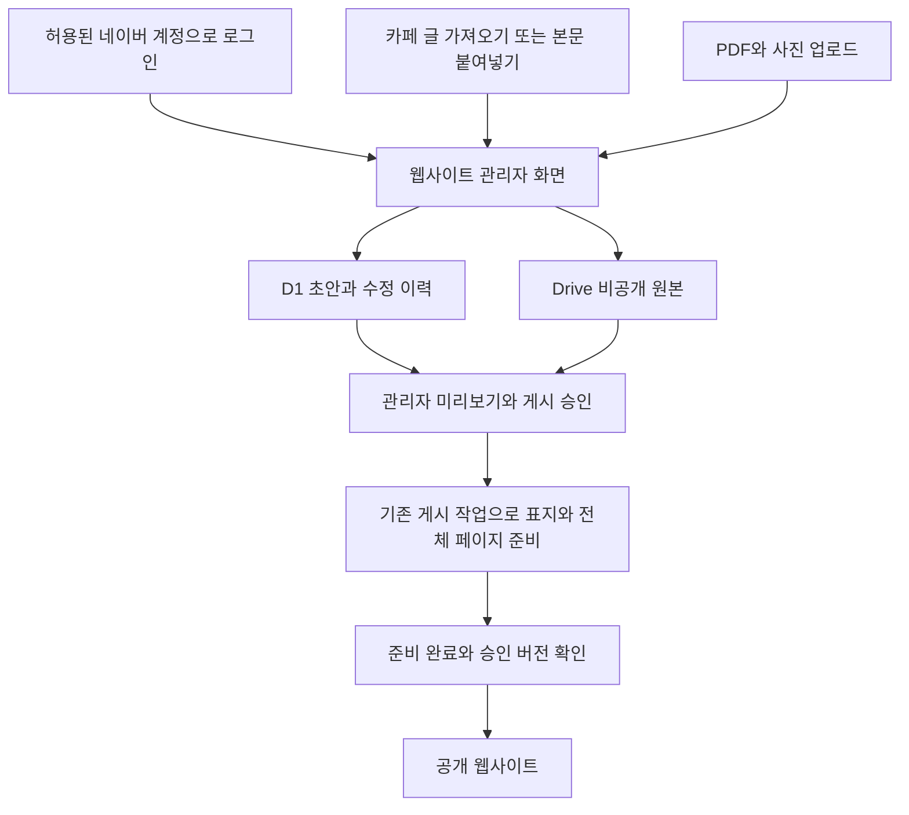

# 웹사이트 관리자 CMS 전환 설계

검토일: 2026-10-24. 상태: 설계안, 미구현.

Notion 대신 웹사이트 관리자 화면에서 공지와 리포트를 관리하는 방안이다. 공개 사이트의 디자인·주소·리포트 읽기 기능은 유지하고, 관리자의 입력과 게시 승인 절차를 바꾼다. 구현·계정 연결·데이터 이전·운영 배포는 이 문서의 범위에 포함하지 않는다.

- 설계 브랜치: `design/admin-cms-cafe-20261024`
- 시작 운영 버전: `d381eb090eb2c3ad8ef109d11ddbdc87acbf6983`
- 변경 범위: 이 문서만 추가. 현재 Notion·Drive·Cloudflare 데이터는 변경하지 않는다.

## 권고안

**자체 관리자 화면 + 네이버 로그인 + 기존 Cloudflare D1 + 학회 Google Drive + 기존 PDF 게시 작업**을 우선안으로 한다. Google Cloud에 새 데이터베이스를 추가할 필요는 없다. 현재도 D1을 사용하지만, 앞으로는 관리자 초안과 수정 이력을 저장하는 역할까지 맡긴다.

PDF 직접 업로드와 게시 승인 흐름은 구현 가능하다. 반면 **네이버 로그인만 연결하면 카페의 새 글 전체를 자동으로 읽고 복제할 수 있다는 전제는 성립하지 않는다.** 카페 가져오기는 독립 기능으로 검증하고, 이 기능이 막혀도 공지 작성과 리포트 관리가 계속 가능하게 한다.

## 네이버 연결에서 가능한 범위

| 요구 | 판단 | 설계 반영 |
| --- | --- | --- |
| 네이버 계정으로 웹사이트 로그인 | 공식 기능으로 가능 | 사용자 식별자를 서버에서 확인하고 미리 지정한 관리자만 허용 |
| 로그인 계정이 카페 관리자임을 자동 확인 | 검토한 공개 API에서 해당 권한 조회를 확인하지 못함 | 카페 직책과 웹사이트 관리 권한을 별도로 관리 |
| 카페 신규 글의 본문·사진·첨부를 모두 자동 수신 | 공개 API만으로 보장할 수 없음 | 로그인 도입과 분리한 실험 기능으로 취급 |
| 공개 카페 글 검색 | 가능하지만 제목·링크·요약 중심 | 새 글 후보 발견에만 사용 가능, 전체 동기화의 근거로 사용하지 않음 |
| 웹사이트에서 작성한 글을 카페에 보내기 | 공식 글쓰기 API가 있음 | 향후 선택 기능. 실제 게시판·본문·이미지 호환성 검증 필요 |

공식 카페 API 문서는 가입·글쓰기를 제공한다. 검색 API는 공개 게시판의 검색 결과를 반환하며 `description`은 본문 전체가 아닌 요약이다. 검토한 공개 문서에서 게시판 전체 읽기, 첨부 수집, 새 글 웹훅은 확인하지 못했다. 제휴 등 별도 API의 존재 여부까지 단정하지 않는다. [카페 API](https://developers.naver.com/docs/login/cafe-api/cafe-api.md), [카페 검색 API](https://developers.naver.com/docs/serviceapi/search/cafearticle/cafearticle.md)

네이버 로그인 토큰은 카페 브라우저 로그인 쿠키가 아니다. 웹사이트가 다른 출처의 카페 화면이나 쿠키를 자동으로 읽을 수도 없다. 네이버 비밀번호·세션 쿠키를 서버에 보관하는 상시 수집기를 기본 운영 구조로 삼지 않는다. 로그인 만료, 보안 확인, 화면 변경에 의존해 인수인계 부담이 크기 때문이다.

개발 시험에는 네이버 애플리케이션의 등록된 관리자·테스터 계정을 사용할 수 있다. 정식 운영 범위에 맞는 검수 절차를 확인하고, 로그인에 불필요한 이름·전화번호 등의 제공 권한은 요구하지 않는다. [네이버 사전 검수](https://developers.naver.com/docs/login/verify/verify.md)

## 공지 관리 경험

### 우선 제공할 안정적인 흐름

1. 관리자 화면에서 공지 제목과 본문을 입력하거나 카페 본문을 붙여넣는다.
2. 사진·첨부를 함께 올리면 글에 연결하고, 빠진 이미지나 지원하지 않는 표현을 표시한다.
3. 원문과 웹사이트 미리보기를 나란히 확인한다. 글 내용과 사진 순서는 유지하고 서체·폭·간격은 사이트 디자인에 맞춘다.
4. 공개할 내용을 확인하고 게시를 승인한다. 미승인 초안은 웹사이트에 노출하지 않는다.
5. 수정은 새 초안으로 저장한다. 재승인 전에는 기존 게시본을 유지한다.

편집기는 제목, 문단, 굵게, 링크, 목록, 인용, 표, 사진·캡션, 첨부, 구분선을 지원한다. 임의 HTML·스크립트·스타일을 그대로 실행하지 않는다. 카페 편집기의 픽셀 단위 복제보다 내용 보존과 웹사이트의 가독성을 우선한다.

### 카페에서 가져오기 후보

| 방법 | 장점 | 제약과 선택 |
| --- | --- | --- |
| 본문 붙여넣기와 사진 첨부 | 별도 수집 서버 없이 작동, 장애 시에도 사용 가능 | 초기 기본 기능으로 권고 |
| 열어 둔 카페 글에서 사용자가 누르는 가져오기 확장 기능 | 카페 작성 흐름을 유지하면서 초안 생성을 간소화 | 이용 조건·접근 권한·본문/사진 추출 시험 필요. 브라우저가 닫혀 있으면 작동하지 않으며 모바일 지원도 별도 문제 |
| 카페 URL만 입력해 가져오기 | 관리자가 쓰기 편함 | 로그인 필요 글과 이미지 접근 실패 가능. 지원 범위를 시험하기 전에는 완전한 가져오기를 약속하지 않음 |
| 서버의 로그인 세션으로 상시 자동 수집 | 원하는 완전 자동 흐름에 가까움 | 인증·보안 확인·페이지 변경에 취약해 기본안에서 제외 |
| 관리자 화면에서 작성하고 카페에도 보내기 | 공식 글쓰기 API를 활용하는 방향 | 카페 우선 작성 습관이 바뀜. 추후 별도 검토 |

확장 기능은 네이버가 제공하는 버튼이 아니라 별도 개발안이다. 허용된 사용자가 열어 본 지정 글만 가져오고, 네이버 로그인 정보는 서버로 보내지 않는다. 외부 사진의 재사용·전송 가능 범위를 확인하며, 차단이나 보안 확인을 우회하지 않는다.

가져온 글은 카페 식별자와 글 번호로 중복을 막는다. 원문 주소·수집 시각·내용 해시를 기록한다. 원문이 바뀌면 변경 비교가 있는 새 초안을 만들고, 원문 삭제만으로 웹사이트 글을 자동 삭제하지 않는다. 장부·연락처 등 카페 내부 자료가 섞일 수 있으므로 가져오기가 곧 공개 승인이 되어서는 안 된다.

사진은 승인된 원본을 학회 저장소로 복사해 참조한다. 만료되는 카페·Notion 이미지 주소를 계속 사용하는 방식은 피한다. 사진이 누락되면 관리자가 보완하거나 제외하기 전까지 게시 준비 완료로 표시하지 않는다.

## 리포트 관리 경험

관리자가 할 일은 **PDF 넣기 → 자동 입력 검토 → 게시 승인**으로 줄인다.

1. PDF를 하나 또는 여러 개 끌어다 놓는다. 초기에 한 번에 최대 5개로 제한하고 개별 진행률·재시도를 제공한다.
2. 관리자 브라우저에서 첫 페이지를 바로 미리 보고, 텍스트가 있는 PDF에서 자동 입력 후보를 추출한다. 원본 업로드는 별도로 진행한다.
3. 기업명·종목코드·발표일·학기·분류·제목 문구·목표연도·목표주가·상승여력을 제안한다. 근거 페이지와 확인 필요 표시를 함께 보여준다.
4. 관리자가 제목·날짜·산업 분류 등을 수정하고 게시를 승인한다.
5. 기존 변환 작업이 고화질 표지와 전체 페이지 읽기 파일을 만든다. 실패하면 재시도 상태를 보여 주며 미완성 글을 게시하지 않는다.
6. 승인한 버전과 실제 원본 해시가 일치하고 준비 파일 검증이 끝나면 공개 목록에 반영한다.

자동 작성은 우선 PDF 원문 추출과 정해진 양식으로 구현한다. 생성형 AI를 필수로 사용하지 않으므로 무료 AI 할당량에 의존하지 않는다. 스캔 PDF나 판독 불가 자료는 수동 입력으로 넘기고, 근거 없이 투자 의견이나 목표주가를 만들어 넣지 않는다. 목표주가를 찾지 못한 경우 관리자의 확인 후 `Not Rated`를 선택한다. 현재 기업 분류와 보고서 발표 시점의 분류가 다를 수 있으므로 적용 기준도 표시한다.

같은 PDF 해시이면 표지와 읽기 파일을 재사용한다. 같은 회사·학기라는 이유만으로 중복 삭제하지 않는다. PDF를 교체하면 불변 파일 버전을 새로 만들고, 준비가 끝날 때까지 기존 게시본을 유지한다. 준비 중 초안을 바꾸면 이전 승인과 작업 결과를 그대로 공개하지 않는다.

### 관리자 메뉴

| 메뉴 | 핵심 기능 |
| --- | --- |
| 게시 대기함 | 확인 필요한 글, 오류, 일괄 검토, 개별 승인 |
| 리포트 | PDF 업로드, 기업/기간 검색, 제목 수정, 버전 교체, 기본 최신순·고정 순서 설정 |
| 공지 | 본문 편집, 카페 원문 비교, 사진 관리, 공개 미리보기 |
| 휴지통 | 삭제 복원, 파일 참조 확인, 영구 삭제 전 유예 |
| 운영 상태 | 저장 공간, 대기 작업, 최근 성공/실패, 계정 연결 상태, 백업 |

평소에는 Notion·Drive·GitHub 콘솔을 열 필요가 없도록 한다. 계정 연결 복구와 권한 인수인계는 별도 운영 작업으로 남는다. 기존 멤버 명단은 초기 전환 범위에서 제외하고 Notion으로 유지한 뒤, 필요하면 다음 단계에 같은 관리자 화면으로 옮긴다.

## 저장소와 처리 구조

### 기존 구성의 재사용

현재 D1의 `free_content`는 공개 콘텐츠를 위한 가공 데이터이고, 초안을 관리하는 원본 DB가 아니다. 공개 확인도 `free/server/publication.ts`에서 Notion을 참조한다. 따라서 업로드 화면만 붙이는 변경으로는 Notion 의존성이 없어지지 않는다. [현재 구조](../architecture.md)

콘텐츠 원본, 파일 저장, 가져오기 기능을 다음 경계로 분리한다. 이름은 구현 시 조정할 수 있다.

- `ContentRepository`: 기존 Notion과 새 관리자 CMS의 읽기·공개 판정 구현을 분리한다.
- `AssetStorage`: Drive 파일 업로드·조회·참조 수·보존을 담당한다. 추후 다른 저장소로 교체할 수 있게 한다.
- `ImportAdapter`: 카페 내용 입력을 공통 본문 형식으로 바꾼다. 카페 오류가 PDF 업로드를 막지 않는다.
- 게시 작업: 승인된 특정 버전만 처리하고, 공개용 데이터를 현재 프런트엔드 계약에 맞게 작성한다.

새 원본 데이터에는 글, 수정 버전, 파일, 가져오기 기록, 처리 작업, 관리자, 세션, 작업 이력을 구분해 저장한다. 기존 테이블을 즉시 덮어쓰거나 삭제하지 않는 추가형 마이그레이션을 사용한다. 콘텐츠별 `source_owner`를 하나로 정해 Notion 동기화와 관리자 편집이 같은 글을 덮어쓰지 않도록 한다.

초안과 공개본은 별도 버전으로 관리한다. 원본 파일은 불변 버전이고, 게시 승인은 글 버전·파일 해시에 결합한다. 오래된 작업은 최신 글을 덮어쓸 수 없다. 공개 판정은 새 소유자 기준으로 처리하고, Notion 웹훅·대조 작업·Drive 삭제 연동은 새 CMS 소유 자료를 건드리지 않는다.

### Drive 사용

원본 PDF와 미승인 사진은 Drive의 비공개 관리 폴더에 저장한다. 예시 구조는 `리포트/연도/학기/글 식별자/버전`, `공지/연도/글 식별자/버전`이다. 파일 이름이나 폴더 이동이 아니라 DB의 파일 ID로 연결한다. 승인된 사진·표지·읽기 파일은 기존 게시 경로로 준비한다.

Google 연결은 학회 저장소 소유자가 초기 설정과 재인증 시 수행한다. 네이버 로그인과는 별개다. 가능한 한 `drive.file` 범위로 앱이 생성하거나 사용자가 지정한 파일만 다룬다. 이 권한을 받았다고 기존 Drive 전체 자료에 접근할 수 있는 것은 아니므로 기존 파일은 선택 공유·이관 또는 기존 읽기 경로 유지가 필요하다. [Drive 권한 범위](https://developers.google.com/workspace/drive/api/guides/api-specific-auth)

큰 PDF는 재개 가능한 업로드를 사용한다. 브라우저에서 Drive 업로드 세션으로 보내는 방식을 먼저 시험하고, 인증·CORS 호환성이 맞지 않으면 인증된 관리자 서버가 작은 청크를 스트리밍하는 방식을 비교한다. 세션 주소는 비밀값으로 취급한다. 업로드 완료 후 서버가 크기·형식·파일 해시를 검증하며 클라이언트의 성공 주장만 믿지 않는다. [Drive 업로드](https://developers.google.com/workspace/drive/api/guides/manage-uploads)

### 무료 공개 빌드와 초안의 분리

현재 저장소는 공개이므로 **미승인 PDF·본문·사진을 공개 GitHub 캐시, 아티팩트, 로그, 커밋에 넣지 않는다.** 승인 전 미리보기와 후보 추출은 우선 관리자 브라우저에서 처리한다. GitHub의 무거운 변환 작업은 공개 승인이 끝난 자료만 받는다. 운영 UI의 승인 버튼은 자료의 공개 배포 준비를 시작한다는 뜻을 명확히 한다.

비공개 서버 변환까지 필요해지면 별도의 비공개 실행 경로와 비용을 검토해야 한다. 공개 저장소의 무료 실행 시간을 비공개 초안 보관 수단으로 사용하지 않는다. 이미 공개된 파일은 내려받은 사본까지 회수할 수 없으므로, 공개 철회와 원본 삭제도 구분한다.

## 무료 운영 판단

아래는 2026-10-24 공식 문서 기준이며, 이 검토에서 계정의 잔여 사용량·결제 설정을 새로 조회한 것은 아니다. 초기 구현과 운영 전환 전에 실제 사용량을 다시 측정한다.

| 구성 | 주요 조건 | 설계 판단 |
| --- | --- | --- |
| Cloudflare Workers Free | 동적 요청 하루 10만 회, 요청당 CPU 10ms | 인증·메타데이터·작업 예약만 담당. PDF 렌더링 제외 |
| D1 Free | 하루 읽은 행 500만·쓴 행 10만, 계정 저장 5GB, 개별 DB 500MB | 글/상태/이력용. PDF 바이너리는 저장하지 않음 |
| Workers 정적 파일 | Free 파일 수 2만 개, 개별 파일 25MiB | 기존 페이지 묶음과 용량 검사를 유지 |
| Google 무료 저장 공간 | 15GB를 Drive·Gmail·Photos 등이 공유 | 원본·수정 버전·사진·백업을 함께 계산 |
| GitHub Actions | 공개 저장소의 표준 호스팅 실행기 사용은 무료, 캐시·아티팩트 별도 한도 | 승인된 사이트 자료 빌드에 사용. 상시 카페 수집 서버로 사용하지 않음 |
| Cloudflare R2 | 무료 포함량 이후 사용량 과금 | 저장소로는 적합하지만 무과금 우선 초기안에서는 제외 |
| Firebase/Google Cloud | Firestore DB와 PDF 저장용 Storage는 별도 상품 | 기존 D1 대체 이익이 작음. Firebase Storage는 Blaze 요건이 있어 자동으로 무료라고 볼 수 없음 |

근거: [Workers 제한](https://developers.cloudflare.com/workers/platform/limits/), [D1 요금](https://developers.cloudflare.com/d1/platform/pricing/), [D1 제한](https://developers.cloudflare.com/d1/platform/limits/), [Google 저장 공간](https://support.google.com/drive/answer/6374270?hl=ko), [Actions 과금](https://docs.github.com/en/actions/concepts/billing-and-usage), [R2 요금](https://developers.cloudflare.com/r2/pricing/), [Firebase Storage 변경](https://firebase.google.com/docs/storage/faqs-storage-changes-announced-sept-2024).

연 20개 리포트의 평균 원본이 20MB라고 가정하면 10년간 약 4GB가 추가된다. 평균이 50MB이면 약 10GB다. 기존 자료, 연 30개 공지의 사진, 수정 버전, 백업, Gmail 사용량은 별도이므로 이 계산만으로 10년 무료를 보장하지 않는다.

현재 읽기 파일의 자체 합계 제한은 4GiB이며 개별 묶음은 24MiB·120페이지 이내다. 새 관리자 화면도 이 한도를 무시하지 않는다. 지원 범위를 넘는 PDF는 승인 전에 알리고, 별도 처리 또는 기존 PDF 보기 대안을 선택하게 한다. [현재 PDF 준비 규칙](../report-covers.md)

무료 한도를 지키기 위한 운영 규칙은 다음과 같다.

- 업로드·변환은 관리자 작업 때만 실행하고, 방문자가 읽을 때 새 변환을 시작하지 않는다.
- 변경 없는 PDF와 표지는 재사용한다. 기존 일일 처리 예산·동시 실행 제한·재시도 제한을 유지한다.
- 관리자 작업이 있을 때만 상태를 확인하고, 대기 시간이 길면 조회 간격을 늘린다.
- 공개 목록은 인덱스와 가공 데이터를 사용한다. 매 방문마다 DB 전체나 Drive 전체를 읽지 않는다.
- 무료 한도에 가까워지면 새 업로드·변환을 먼저 중단한다. 이 조치가 공개 서비스의 한도 초과까지 막는다는 보장은 없으므로 공개 요청 사용량도 따로 감시한다.
- 시험·운영 자원은 분리하되 계정의 공통 할당량을 함께 계산한다. 무료 제한 우회를 위한 계정 증설은 하지 않는다.

D1 Free의 일일 한도 초과는 쿼리 실패로 이어질 수 있다. 자동 과금이 없다는 것과 중단 없이 무제한 이용할 수 있다는 것은 다르다. 또한 자체 관리자 CMS는 Notion 사용 부담을 줄이는 대신 인증·업로드·편집기 코드를 유지해야 한다. 토큰 갱신, 보안 업데이트, 복구 연습까지 없어지는 구조는 아니다.

## 접근 권한과 인수인계

공개 사이트와 관리자 서버의 권한을 분리한다. 네이버가 확인한 고정 사용자 식별자에 관리자 권한을 연결한다. 최초 로그인한 사람에게 관리자 권한을 자동 부여하거나 이메일·닉네임만으로 권한을 판단하지 않는다.

세션은 서버에서 관리하고, 보안 쿠키·CSRF 방어·로그아웃/권한 회수·로그인 시도 제한을 적용한다. 토큰은 서버 비밀 저장소에 두며 공개 코드와 브라우저 저장소에 장기 권한을 넣지 않는다. 외부 콘텐츠는 정제하고 외부 URL 가져오기는 허용 출처·리다이렉트·내부 주소 접근을 제한한다. PDF 처리에는 용량·페이지 수·시간 제한을 둔다.

초안은 `noindex`만으로 보호하지 않는다. 본문과 이미지 직접 주소에도 인증이 필요하다. 관리자 응답은 공개 캐시에 넣지 않는다. 원본 삭제는 게시 철회, 다른 글의 참조 검사, 휴지통 유예를 거친다.

학기 교체 때는 새 담당자의 네이버 식별자를 등록하고 이전 담당자 권한과 세션을 회수한다. 개인 비밀번호 공유가 없어도 운영할 수 있는 방향이다. 학회 소유 저장소 연결, 별도 복구 책임자, 백업 위치, 연결 재인증 절차를 인수인계서에 남긴다. 매 학기 한 번 로그인·업로드·게시·복원을 확인한다.

## 구현 순서와 통과 기준

| 단계 | 작업 | 다음 단계 조건 |
| --- | --- | --- |
| 0 설계 | 이 문서와 운영 기준 커밋 보존 | 운영 코드와 데이터 변경 없음 |
| 1 화면 검증 | 가상 자료로 관리자 화면·PDF 후보 추출·미리보기 | 로그인·외부 계정 연결 없이 관리 흐름 검토 |
| 2 격리 시험 | 별도 시험 Worker·D1·Drive 폴더, 네이버 로그인, 업로드·초안 | 별도 권한 연결 승인 후 진행. 운영 자료 변경·공개 없음 |
| 3 게시 시험 | 공개 가능한 샘플 PDF 3~5개와 공지 2개 | PC/모바일 페이지 이동·확대·다운로드, 승인 버전, 비용 측정 통과 |
| 4 제한 전환 | 새 리포트부터 원본 소유자를 관리자 CMS로 지정 | 기존 Notion 글과 주소 유지, 역방향 내보내기·복구 시험 완료 |
| 5 확대 | 공지와 기존 자료를 단계적으로 이전 | 새 운영 안정성과 백업 검증 후 Notion 자동화 범위 축소 |

카페 가져오기 실험은 2~3단계와 별도로 한다. 로그인이나 이미지 추출이 불안정하면 붙여넣기 기능으로 먼저 운영하고, PDF CMS 전환을 막지 않는다.

필수 검증 사례:

- 허용되지 않은 계정은 관리자 화면과 API 모두 접근 불가. 로그아웃·권한 회수 즉시 반영.
- 초안과 첨부 직접 주소, 공개 캐시, 빌드 로그·캐시에 미승인 자료 노출 없음.
- 업로드 도중 연결이 끊겨도 재개 가능. 위조 형식·과대 파일·깨진 PDF는 안전하게 실패.
- 변환 실패·관리자 수정·동시 승인·오래된 작업 완료가 잘못된 버전을 공개하지 않음.
- 같은 PDF 재게시 때 재변환 없음. PDF 교체 때 새 버전만 게시.
- 카페 재가져오기는 중복 생성하지 않고, 원문 변경은 재검토 대상으로 표시.
- 기존 리포트 URL·정렬·검색·목록 복귀·전체 페이지 읽기·다운로드 유지.
- 한도에 근접한 상황에서 처리 대기와 재시도가 제한되고 기존 게시 자료가 보존됨.
- Notion 동기화와 Drive 정리 작업이 새 CMS 소유 자료를 삭제하지 않음.
- 새 관리자에서 만든 글까지 포함한 복구 훈련 성공.

## 롤백

**현재는 문서만 추가하므로 브랜치 전환만으로 원래 코드 상태로 돌아갈 수 있다.** 향후 데이터를 쓰기 시작하면 Git 롤백만으로는 충분하지 않다.

이전 전에는 D1 내보내기, Notion 콘텐츠 내보내기, Drive 파일 ID·해시 목록, 게시 파일 목록, 운영 배포 버전을 비공개 백업으로 보존한다. 기존 글의 공개 ID와 URL을 유지한다. 전환 기간에는 기존 Notion 자료를 삭제하지 않는다.

실제 복귀 절차는 다음과 같다.

1. 관리자 쓰기와 새 게시 작업을 멈추고 현재 데이터의 추가 백업을 만든다.
2. 전환 이후 추가·수정한 게시물을 역방향으로 내보낸다. 원래 Notion 기반 런타임으로 돌아갈 경우 Notion에 해당 자료를 복구하고 ID 대응을 확인한다.
3. 기존/신규 게시물의 공개 상태·첨부·주소를 검증한 뒤 콘텐츠 원본 소유자를 되돌린다.
4. 호환되는 운영 버전으로 배포하고 공개 화면과 다운로드를 확인한다. 위 시작 버전은 기준점이며, 이후 다른 운영 개선이 있다면 그것을 보존하는 복귀 버전을 선택한다.
5. 새 DB·수정 이력·파일은 즉시 삭제하지 않고 보존한다.

단순 설정 전환만으로 새 관리자에서만 만든 글까지 과거 코드에 나타나는 것은 아니다. 이 역방향 내보내기가 검증되기 전에는 전체 전환하지 않는다.

## 구현 전에 남은 선택

우선 구현 후보는 자체 PDF 관리와 수동/보조 카페 가져오기다. 완전 자동 카페 복제, 생성형 AI 자동 작성, 새 유료 저장소는 초기 필수 항목에서 제외한다.

실제 구현에 착수할 때 네이버 개발자 앱·관리자 식별자, 학회 Drive 연결 방식, 시험 자원 생성 범위를 확인해야 한다. 이 설계 브랜치에서는 해당 권한을 만들거나 계정을 연결하지 않는다.
